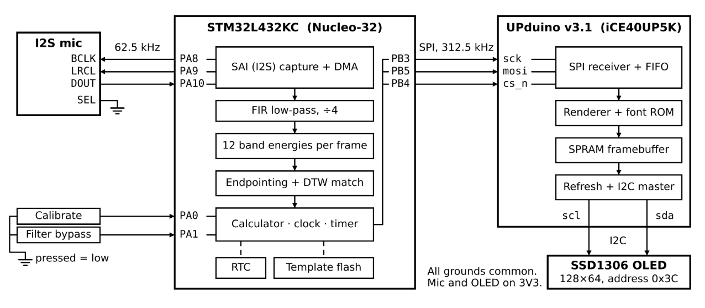
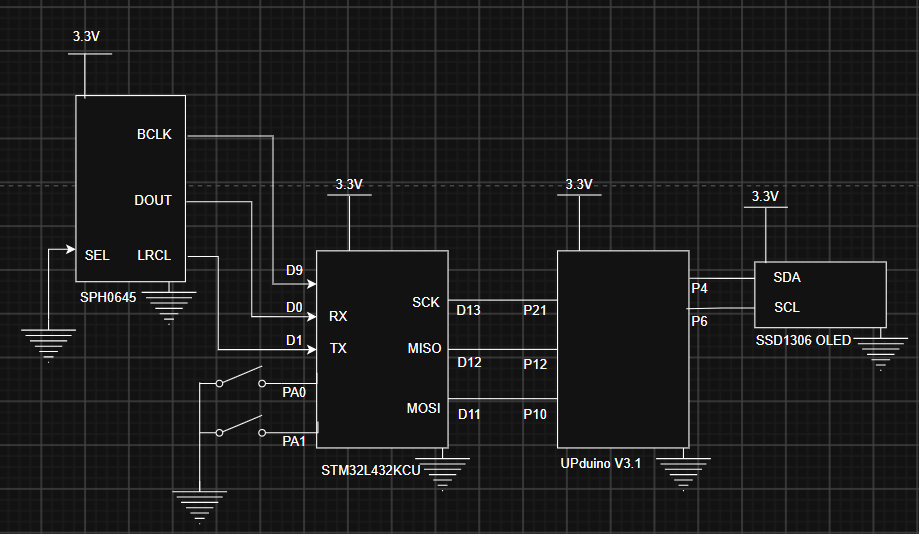

## Status Summary

The Voice-Integrated Calculator (VIC) is a calculator, clock and timer controlled entirely by voice. The user says one word at a time, such as "seven," "multiply," "six," "equals," and VIC shows the result on a small OLED screen. Our system splits the work between the two boards. The STM32 microcontroller (MCU) listens to a microphone and decides which word was spoken. The FPGA takes care of the display, so the MCU only has to send it short text commands over SPI.

At the midpoint, the hardware path from microphone to screen works end to end. The MCU continuously reads audio from our I2S microphone. It detects each spoken word by comparing loudness to the background noise level in the room, and reports it on the OLED along with the word's length. The screen also shows a running clock and a live microphone level bar. All of the display text is drawn by the FPGA, whose design is complete. This is what we will demonstrate at checkoff.

What the hardware cannot do yet is tell *which* word was said. Before writing that part in C, we built the full recognition algorithm in Python to make sure it would work. On real recordings it identified words correctly 93% of the time, which beats the 90% goal from our proposal (@sec-risk). Our remaining work is to move that algorithm onto the MCU, add a way for the user to record and save their own word templates, build the calculator, clock and timer logic that responds to recognized words, and wire up the two control buttons.

## System Block Diagram

@fig-system shows how the parts of VIC connect. The microphone sends audio to the MCU over I2S. The MCU sends display commands to the FPGA over SPI, and the FPGA drives the OLED over I2C. Two buttons connect to MCU GPIO pins. Some of the MCU blocks in the diagram show the final design rather than what runs today. The FIR filter, band energies, DTW matching and calculator are still in Python, and the current demo uses simpler loudness-based word detection in their place.

{#fig-system width=100%}

## Breadboard Schematics

@fig-breadboard shows the circuit on our breadboard. The microphone and OLED are powered from 3.3 V and share a common ground with both boards. The microphone's SEL pin is tied to ground so that it sends its audio on the left I2S channel. The MCU and FPGA sit together on the E155 development board, so the SPI link between them uses the board's own traces. The pin labeled MISO (D12) carries the SPI chip-select signal instead, since the FPGA never sends data back. The two buttons pull PA0 and PA1 to ground when pressed.

{#fig-breadboard width=95%}

## FPGA Design

<!-- TODO: add the FPGA block diagram:
     {width=90%} -->

The FPGA's job is to turn simple commands from the MCU into pixels on the OLED. This keeps the MCU free to focus on audio, which needs most of its processing time. To print a word on the screen, the MCU only sends a few bytes: a command, a position, a font size and the characters.

Inside the FPGA, those bytes move through a short pipeline. The `spi_rx` module receives each byte from the MCU and passes it into a small FIFO, which holds the bytes until the next stage is ready. The `renderer` then reads each command. For text, it looks up each letter's shape in a font ROM, scales it to the requested size, and writes the resulting pixels into a framebuffer. The framebuffer is a 1 KB block of on-chip memory that holds every pixel of the 128×64 screen. Separately, the `oled_refresh` module configures the OLED when power comes on, then continuously copies the framebuffer to the screen through our `i2c_tx` I2C controller. Because drawing and refreshing are separate, the MCU can update one line of text without redrawing the whole screen.

Besides drawing text, the renderer can clear the screen, make selected rows blink, invert the colors, and draw small images. We will use these for the calculator and timer interface. At power-on, the FPGA displays "FPGA OK" by itself, which let us test the display before the MCU code was ready. An LED turns on if the OLED ever stops responding, which made wiring problems easy to spot.

## MCU Routines

The MCU firmware is written in C and controls the chip's peripherals directly through their registers. At startup it configures the system clock, a UART for debug messages, the SPI link to the FPGA, the real-time clock, and the I2S interface to the microphone. From then on, audio capture runs in the background. The I2S peripheral and DMA fill a buffer with microphone samples without any work from the CPU. Every 16 ms an interrupt measures how loud that piece of audio was and places the result in a queue.

The main loop reads loudness values from that queue and decides when a word begins and ends. A word starts once the sound stays well above the room's background noise for a few pieces in a row, and it ends once the sound drops back down. The background level is updated continuously, so detection still works if the room gets louder or quieter. A few times per second, the main loop also refreshes the clock, the word count and the level bar on the screen by sending text commands to the FPGA.

Everything described above runs on the hardware today. The next routines to add will sit right after word detection. Once a word's start and end are known, the MCU will compute its frequency-band fingerprint and match it against the stored templates using DTW. A state machine will then turn the sequence of recognized words into calculator, clock and timer actions. All of the recognition steps are already working in Python, so this stage is mostly a translation into C.

## Riskiest Element {#sec-risk}

In our proposal, we named speech recognition accuracy as the riskiest part of the project, especially in the presence of background noise. Our plan was to record real audio, run our matching algorithm in Python, and show at least 90% accuracy by the midpoint.

The recognizer works by comparing each spoken word to saved recordings of every word in the vocabulary. It first splits the audio into 16 ms pieces and measures how much energy falls into each of 12 frequency bands, giving a kind of fingerprint of the word over time. It then compares that fingerprint against each saved template using dynamic time warping (DTW). DTW stretches or compresses the timing so that the same word still matches when it is spoken faster or slower. The closest template is chosen as the answer. If no template is close enough, the sound is rejected instead of being guessed.

To test accuracy, one team member recorded each of the 19 vocabulary words three times. We used two recordings of each word as templates and tested with the third, then rotated so each recording served as the test once. The recognizer got 53 of 57 words right, or **93%**, which meets our 90% goal (@tbl-acc). Three of the four mistakes were between words that sound alike, plus/minus and five/nine. Recording more templates per word should help with these. @fig-poc shows one example of the algorithm correctly identifying the word "nine."

| Test round | Correct | Mistakes |
|------------|---------|----------|
| 1 | 17 / 19 | minus→plus, three→one |
| 2 | 18 / 19 | five→nine |
| 3 | 18 / 19 | plus→minus |
| **Total** | **53 / 57 (93%)** | |

: Word recognition accuracy on real recordings {#tbl-acc}

{#fig-poc width=85%}

We also tested how background noise affects accuracy. Templates recorded in a quiet room stopped matching once the test audio became noisy. Templates recorded in the same noise as the test audio stayed near 90% accurate, even at fairly high noise levels. This tells us that VIC should have users record their templates in the room where they will use it. That is the purpose of the Calibrate button, which will let users re-record their templates whenever the room changes.

Our proposal also raised three smaller concerns. The first was microphone signal quality. We have since switched from a PDM microphone to an I2S microphone (the SPH0645), which handles the low-level conversion itself and sends clean digital samples; it is already working on our hardware. The second was rounding error when the algorithm moves from Python to fixed-point C. Our Python model already uses the same number sizes the MCU will use, so the 93% result accounts for most of that effect. The third was that the system would have only a few voices to learn from. Because each user records their own templates, VIC adapts to whoever is using it rather than depending on a fixed library. We still plan to test it with each teammate's voice.

## Parts Status

<!-- TODO: confirm OLED part number and that every part is in hand -->

All of the parts VIC needs have been received, and nothing else needs to be ordered (@tbl-parts). The FPGA and MCU boards come from the E155 kit. The microphone, OLED and buttons are already on our breadboard.

| Part | Part number | Qty | Status |
|------|-------------|-----|--------|
| I2S microphone | SPH0645LM4H (Adafruit 3421) | 1 | In hand |
| OLED display, 128×64 | SSD1306 I2C module | 1 | In hand |
| Pushbutton | tactile switch | 2 | In hand |
| UPduino v3.1 FPGA | — | 1 | In hand (E155 kit) |
| Nucleo-L432KC MCU | — | 1 | In hand (E155 kit) |

: Parts {#tbl-parts}

## Appendix A: MCU Code

Full source: [src/midpointmain.c](https://github.com/EduardoAmbrizLazo/voice-integrated-calculator/blob/main/src/midpointmain.c)

```c
// midpointmain.c
int main(void)
{
    hw_init();
    log_str("\r\nmidpoint (single file)\r\n");
#if STEP == 1
    uint32_t last = 0, secs = 0;
    disp_clear();
    disp_line(0, 1, "STEP 1: MCU TO FPGA", 0);
    disp_line(2, 3, "HELLO", 1);
    for (;;) {
        if (g_ms - last >= 1000) {
            char b[24], *p = put_str(b, "SECONDS ");
            last += 1000;
            put_int(p, ++secs);
            disp_line(7, 1, b, 0);
            log_str(".");
        }
    }
#else
    rtc_init();                                 /* can take a few seconds the first time */
    screen_init();
    mic_start();
    for (;;) loop_once();
#endif
}
```

```c
// midpointmain.c
static void audio_half(const int32_t *w)
{
    dbg_irq++;
    dbg_l = ((uint32_t)w[0] >> 14) & 0x3FFFF;   /* one raw sample from each channel */
    dbg_r = ((uint32_t)w[1] >> 14) & 0x3FFFF;
    for (int i = 0; i < HALF_FRAMES; i += 4) {
        int32_t x = 0;
        for (int k = 0; k < 4; k++) x += w[2 * (i + k) + I2S_SLOT] >> 14;   /* 18-bit samples */
        x >>= 2;                                /* average of 4: 62.5 kHz -> 15.6 kHz */
        dc += (x - dc) >> 7;                    /* remove the DC offset               */
        x -= dc;
        acc += (uint64_t)((int64_t)x * x);
    }
    if (++halves < 2) return;
    halves = 0;
    int e = log8(acc);
    acc = 0;
    dbg_e = (uint32_t)e;
    uint8_t next = (uint8_t)((q_head + 1) & 15);
    if (next != q_tail) { q[q_head] = (uint8_t)(e > 255 ? 255 : e); q_head = next; }
}

void DMA2_Channel1_IRQHandler(void)
{
    uint32_t isr = DMA2->ISR;
    if (isr & DMA_ISR_HTIF1) { DMA2->IFCR = DMA_IFCR_CHTIF1; audio_half(&dma_buf[0]); }
    if (isr & DMA_ISR_TCIF1) { DMA2->IFCR = DMA_IFCR_CTCIF1; audio_half(&dma_buf[2 * HALF_FRAMES]); }
}
```

```c
// midpointmain.c
static void on_slice(int e)                     /* e = loudness of one 16 ms slice    */
{
    if (floor_q4 < 0) floor_q4 = e << 4;
    int fl = floor_q4 >> 4, loud = e > fl + ON_MARGIN, quiet = e < fl + OFF_MARGIN;
    if (e - fl > peak) peak = e - fl;

    if (!in_word) {
        if (loud) {
            if (++loud_run >= 3) { in_word = 1; frames = loud_run; quiet_run = 0; }
        } else {
            loud_run = 0;                       /* follow the room: down fast, up slowly */
            floor_q4 += ((e << 4) - floor_q4) / (((e << 4) < floor_q4) ? 4 : 32);
        }
        return;
    }
    frames++;
    quiet_run = quiet ? quiet_run + 1 : 0;
    if (frames > 60) floor_q4 += 8;             /* stuck "loud": the room got noisier */
    if (quiet_run < 8) return;

    in_word = 0; loud_run = 0;
    if (frames - 8 > 50) { draw("TOO LONG - TRY AGAIN"); log_str("sound too long\r\n"); return; }
    char b[32], *p;
    words++;
    last_ms = (uint32_t)(frames - 8) * 16;
    p = put_str(big, "WORD "); put_int(p, words);
    draw(0);
    p = put_str(b, "WORD "); p = put_int(p, words); p = put_str(p, "  ms="); p = put_int(p, last_ms);
    put_str(p, "\r\n"); log_str(b);
}
```

## Appendix B: FPGA Code

Full source: [src/fpga/](https://github.com/EduardoAmbrizLazo/voice-integrated-calculator/tree/main/src/fpga)

```verilog
// fpga/top.sv
    // SPI Reciever and FIFO 
    logic       rx_valid, rx_first;
    logic [7:0] rx_data;
    spi_rx u_rx (.clk, .rst_n, .sck(spi_sck), .mosi(spi_mosi), .cs_n(spi_cs_n),
                 .valid(rx_valid), .first(rx_first), .data(rx_data));

    logic       ff_valid, ff_pop;
    logic [8:0] ff_q;
    fifo #(.W(9), .AW(4)) u_fifo (.clk, .rst_n, .push(rx_valid), .din({rx_first, rx_data}),
```

```verilog
// fpga/spi_rx.sv
    always_ff @(posedge clk) begin
        sck_s  <= {sck_s[1:0], sck};
        cs_s   <= {cs_s[1:0], cs_n};
        mosi_s <= {mosi_s[0], mosi};
    end
    wire sck_rise = sck_s[1] & ~sck_s[2];

    always_ff @(posedge clk) begin
        valid <= 1'b0;
        if (!rst_n || cs_s[1]) begin
            nbit <= 3'd0;
            is_first <= 1'b1;
        end else if (sck_rise) begin
            sh   <= {sh[5:0], mosi_s[1]};
            nbit <= nbit + 3'd1;
            if (nbit == 3'd7) begin
                valid    <= 1'b1;
                data     <= {sh, mosi_s[1]};
                first    <= is_first;
                is_first <= 1'b0;
            end
        end
    end
```
